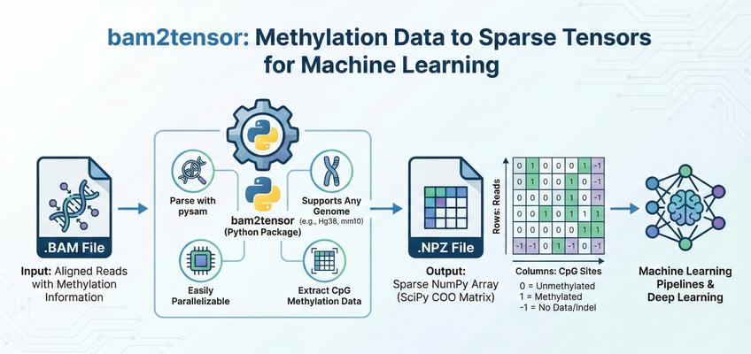

# bam2tensor

**Author:** [Nick Semenkovich](https://nick.semenkovich.com/) (semenko@alum.mit.edu)

[][pypi status]
[][pypi status]
[][pypi status]
[][license]

[][documentation]
[][tests]
[][coverage]

[][pre-commit]
[][black]
[](https://github.com/astral-sh/ruff)

[pypi status]: https://pypi.org/project/bam2tensor/
[documentation]: https://mcwdsi.github.io/bam2tensor
[tests]: https://github.com/mcwdsi/bam2tensor/actions?workflow=Tests
[coverage]: https://htmlpreview.github.io/?https://github.com/mcwdsi/bam2tensor/blob/python-coverage-comment-action-data/htmlcov/index.html
[pre-commit]: https://github.com/pre-commit/pre-commit
[black]: https://github.com/psf/black

**bam2tensor** is a Python package for converting bisulfite-sequencing (BS-seq) and enzymatic methylation sequencing (EM-seq) `.bam` files to sparse tensor representations of DNA methylation data. It extracts the methylation state of every CpG on every sequenced DNA fragment — one matrix row per fragment, with the two mates of a read pair combined — and outputs efficient sparse COO matrices as `.npz` files, ready for deep learning pipelines.



## Table of Contents

- [Features](#features)
- [Requirements](#requirements)
- [Installation](#installation)
- [Quick Start](#quick-start)
- [Usage](#usage)
  - [Basic Usage](#basic-usage)
  - [Auto-Download Reference Genomes](#auto-download-reference-genomes)
  - [Processing Multiple BAM Files](#processing-multiple-bam-files)
  - [Custom Output Directory](#custom-output-directory)
  - [Using a Custom Genome](#using-a-custom-genome)
  - [Command-Line Options](#command-line-options)
- [Filtering Conversion Errors](#filtering-conversion-errors)
- [Inspecting Output Files](#inspecting-output-files)
- [Output Data Structure](#output-data-structure)
  - [How Reads Become Rows](#how-reads-become-rows)
  - [Fragment Length (TLEN)](#fragment-length-tlen)
  - [Embedded Metadata](#embedded-metadata)
  - [Loading Output Files](#loading-output-files)
  - [Converting to Dense Arrays](#converting-to-dense-arrays)
  - [Working with Genomic Coordinates](#working-with-genomic-coordinates)
- [Supported Aligners](#supported-aligners)
- [Performance Tips](#performance-tips)
- [API Reference](#api-reference)
- [Contributing](#contributing)
- [AI Coding Agents](#ai-coding-agents)
- [License](#license)
- [Credits](#credits)

## Features

- **BAM Parsing**: Efficiently parses `.bam` files using [pysam](https://github.com/pysam-developers/pysam)
- **Complete CpG Extraction**: Extracts methylation data from all CpG sites genome-wide
- **Multi-Genome Support**: Works with any reference genome (GRCh38/hg38, T2T-CHM13, mm10, etc.)
- **Sparse Storage**: Stores data in sparse COO matrix format for memory-efficient loading
- **NumPy/SciPy Integration**: Exports to `.npz` files compatible with NumPy and SciPy
- **One Row per Fragment**: The two mates of a read pair are combined into a single row, so each molecule is counted once and CpGs covered by both mates are not double-counted
- **Both Strands, Every Aligner**: Each read is decoded on the base that carries its call, so top- and bottom-strand fragments are both used
- **Efficient Algorithm**: Linear-scan algorithm ensures minimal memory usage
- **Batch Processing**: Process multiple BAM files with directory recursion
- **Caching**: CpG site indexing is cached to accelerate repeated runs on the same genome
- **Quality Filtering**: Configurable mapping quality thresholds
- **Fragment Length**: Stores each fragment's length (BAM TLEN) alongside the methylation tensor for joint fragment-methylation analysis
- **Conversion-Error Filters**: Optional filters for incomplete bisulfite/EM-seq conversion (ported from `nebiolabs/mark-nonconverted-reads`) and EM-seq fragment-level over-conversion (Loyfer et al. 2026)

## Requirements

- Python 3.10 or higher
- A reference genome FASTA file (must match the genome used for alignment)
- Indexed BAM files (`.bam` with corresponding `.bam.bai` index files)

### Dependencies

Core dependencies are automatically installed:
- `pysam` - BAM file handling
- `biopython` - FASTA parsing
- `scipy` - Sparse matrix operations
- `numpy` - Numerical operations
- `click` - Command-line interface
- `tqdm` - Progress bars

## Installation

### From PyPI (Recommended)

```bash
pip install bam2tensor
```

### From Source

```bash
git clone https://github.com/mcwdsi/bam2tensor.git
cd bam2tensor
pip install .
```

### Development Installation

```bash
git clone https://github.com/mcwdsi/bam2tensor.git
cd bam2tensor
uv sync
```

## Quick Start

```bash
# Basic usage with a single BAM file
bam2tensor \
    --input-path sample.bam \
    --reference-fasta GRCh38.fa \
    --genome-name hg38

# This creates: sample.methylation.npz
```

## Usage

### Basic Usage

Process a single bisulfite-sequencing or EM-seq BAM file:

```bash
bam2tensor \
    --input-path /path/to/aligned_reads.bam \
    --reference-fasta /path/to/reference.fa \
    --genome-name hg38
```

This will:
1. Parse the reference FASTA to identify all CpG sites (cached for future runs)
2. Extract methylation states from each read in the BAM file, combining the two mates of each pair into one fragment
3. Output a sparse matrix to `aligned_reads.methylation.npz`

### Auto-Download Reference Genomes

Don't have a local reference FASTA? bam2tensor can download and cache common reference genomes automatically:

```bash
# Download hg38 and process a BAM file in one command
bam2tensor \
    --input-path sample.bam \
    --download-reference hg38

# List available genomes
bam2tensor --input-path sample.bam --list-genomes
```

Available genomes: `hg38`, `hg19`, `mm10`, `T2T-CHM13`. Downloaded references are cached in `~/.cache/bam2tensor/` for future runs.

### Processing Multiple BAM Files

Process all BAM files in a directory recursively:

```bash
bam2tensor \
    --input-path /path/to/bam_directory/ \
    --reference-fasta /path/to/reference.fa \
    --genome-name hg38 \
    --verbose
```

Each BAM file will generate a corresponding `.methylation.npz` file in the same location.

If a BAM cannot be processed (for example its index is missing, or its chromosome names do not match the reference), bam2tensor reports the error, carries on with the remaining files, and lists the failures in the final summary. The exit status is `1` if any BAM failed and `0` otherwise, so schedulers and pipelines can detect a partial failure.

### Custom Output Directory

Write output files to a specific directory instead of next to the input BAMs:

```bash
bam2tensor \
    --input-path /shared/bams/ \
    --reference-fasta /shared/ref/GRCh38.fa \
    --genome-name hg38 \
    --output-dir /scratch/methylation_output/
```

This is useful on HPC clusters where input directories may be read-only or on slow shared storage.

### Using a Custom Genome

For non-human genomes or custom chromosome sets:

```bash
# Mouse genome (mm10)
bam2tensor \
    --input-path mouse_sample.bam \
    --reference-fasta mm10.fa \
    --genome-name mm10 \
    --expected-chromosomes "chr1,chr2,chr3,chr4,chr5,chr6,chr7,chr8,chr9,chr10,chr11,chr12,chr13,chr14,chr15,chr16,chr17,chr18,chr19,chrX,chrY"

# T2T-CHM13 human genome
bam2tensor \
    --input-path sample.bam \
    --reference-fasta chm13v2.0.fa \
    --genome-name T2T-CHM13 \
    --expected-chromosomes "chr1,chr2,chr3,chr4,chr5,chr6,chr7,chr8,chr9,chr10,chr11,chr12,chr13,chr14,chr15,chr16,chr17,chr18,chr19,chr20,chr21,chr22,chrX,chrY"
```

### Command-Line Options

```
Usage: bam2tensor [OPTIONS]

  Extract per-fragment methylation data from an aligned bisulfite-seq or EM-
  seq .bam file and export the data as a SciPy sparse matrix (one row per
  sequenced DNA fragment).

Options:
  --version                       Show the version and exit.
  --input-path PATH               Input .bam file OR directory to recursively
                                  process.  [required]
  --genome-name TEXT              A custom string referring to your genome
                                  name, used to save a cache file (e.g. hg38,
                                  hg39-no-alt, etc.).
  --expected-chromosomes TEXT     A comma-separated list of chromosomes to
                                  expect in the .fa genome. Defaults to hg38
                                  chromosomes.
  --reference-fasta FILE          Reference genome fasta file (critical to
                                  determine CpG sites).
  --quality-limit INTEGER         Quality filter for aligned reads (default =
                                  20)
  --filter-non-converted          Drop fragments in which a read has >= --non-
                                  converted-threshold retained non-CpG
                                  cytosines, the signature of incomplete
                                  bisulfite/EM-seq conversion (port of
                                  nebiolabs/mark-nonconverted-reads). Default:
                                  off.
  --non-converted-threshold INTEGER
                                  Minimum count of retained non-CpG cytosines
                                  in a read for its fragment to be dropped
                                  (default = 3, matches NEB mark-nonconverted-
                                  reads).
  --filter-em-overconversion      Drop EM-seq fragments whose covered CpGs are
                                  all called unmethylated and cover at least
                                  --em-overconversion-min-cpgs sites
                                  (heuristic for the fragment-level over-
                                  conversion artifact described in Loyfer et
                                  al. bioRxiv 2026.03.24.713040). Default:
                                  off.
  --em-overconversion-min-cpgs INTEGER
                                  Minimum covered CpG count required before
                                  the EM over-conversion filter will drop a
                                  fragment (default = 3).
  --threads INTEGER               Number of worker processes for per-
                                  chromosome extraction (default = 1). With
                                  threads > 1, chromosomes are fanned out
                                  across worker processes. Output is bitwise-
                                  identical to the single-threaded path.
                                  Recommended: number of physical cores for
                                  whole-genome WGBS/EM-seq BAMs.
  --verbose                       Verbose output.
  --skip-cache                    De-novo generate CpG sites (slow).
  --debug                         Debug mode (extensive validity checking +
                                  debug messages).
  --overwrite                     Overwrite output file if it exists.
  --output-dir DIRECTORY          Output directory for .methylation.npz files.
                                  Defaults to same directory as the input BAM.
  --download-reference [t2t-chm13|hg19|hg38|mm10]
                                  Download and cache a known reference genome
                                  (e.g. hg38, hg19, mm10, T2T-CHM13). Use
                                  --list-genomes to see options.
  --list-genomes                  List available reference genomes for
                                  download and exit.
  --help                          Show this message and exit.
```

#### Option Details

| Option | Description |
|--------|-------------|
| `--input-path` | Path to a single `.bam` file or a directory. If a directory is provided, all `.bam` files are processed recursively. |
| `--genome-name` | An identifier for your reference genome (e.g., `hg38`, `mm10`). Used to name the cache file for CpG site positions. |
| `--expected-chromosomes` | Comma-separated list of chromosome names to process. Chromosomes not in this list are skipped. Defaults to human autosomes + sex chromosomes. |
| `--reference-fasta` | Path to the reference genome FASTA file. Must match the genome used for alignment. |
| `--quality-limit` | Minimum mapping quality score (MAPQ) for reads to be included. Default is 20. |
| `--filter-non-converted` | Drop fragments in which a read has at least `--non-converted-threshold` retained non-CpG cytosines (incomplete conversion). See [Filtering Conversion Errors](#filtering-conversion-errors). |
| `--non-converted-threshold` | Threshold for the non-converted filter. Default is 3. |
| `--filter-em-overconversion` | Drop EM-seq fragments whose covered CpGs are all unmethylated and cover ≥ `--em-overconversion-min-cpgs` sites. See [Filtering Conversion Errors](#filtering-conversion-errors). |
| `--em-overconversion-min-cpgs` | Minimum covered CpG count before the EM over-conversion filter will drop a fragment. Default is 3. |
| `--threads` | Number of worker processes for per-chromosome extraction. Default is 1 (single process). Output is bitwise-identical regardless of the value. See [Performance Tips](#performance-tips). |
| `--verbose` | Enable detailed progress output including per-chromosome progress bars. |
| `--skip-cache` | Force regeneration of CpG site cache. Useful if you've modified the reference or chromosome list. |
| `--debug` | Print the calls decoded from every read and each filter decision. Slower but useful for troubleshooting. |
| `--overwrite` | Overwrite existing `.methylation.npz` files. Without this flag, existing outputs are skipped. |
| `--output-dir` | Write `.methylation.npz` files to this directory instead of next to the input BAMs. Created automatically if it doesn't exist. |
| `--download-reference` | Download and cache a known reference genome. Choices: `hg38`, `hg19`, `mm10`, `T2T-CHM13`. Replaces `--reference-fasta`. |
| `--list-genomes` | List available reference genomes for `--download-reference` and exit. |

## Filtering Conversion Errors

Bisulfite and EM-seq library preparation can produce two kinds of conversion errors that bias downstream methylation calls. bam2tensor provides two opt-in filters to drop affected fragments at extraction time. Both are **default-off**, remove whole fragments (rows), and are recorded in the output `metadata.json` so downstream consumers know which filters were applied.

### `--filter-non-converted` — incomplete conversion

Ports the logic of [nebiolabs/mark-nonconverted-reads](https://github.com/nebiolabs/mark-nonconverted-reads). A read is flagged if it carries at least `--non-converted-threshold` (default 3) retained non-CpG cytosines, a signature of incomplete bisulfite or EM-seq conversion. The threshold is applied to each read separately, as in the NEB tool; because incomplete conversion is a property of the molecule, a flagged read removes its whole fragment, mate included.

- **Bismark BAMs**: counted directly from the `XM` tag's uppercase `H`/`X`/`U` characters (retained cytosines in CHH/CHG/unknown contexts).
- **Biscuit / bwameth / gem3 BAMs**: counted by comparing the read to the reference via the `MD` tag (using pysam's `get_aligned_pairs(with_seq=True)`). SNPs — where the read's retained `C` sits over a reference base that isn't `C` — are excluded from the count, matching NEB's reference-validation step. No separate FASTA reload is required. Reads **without** an `MD` tag cannot be evaluated: they are kept, and bam2tensor prints a warning with the number of affected reads. If your aligner did not write `MD` tags, add them first with `samtools calmd`.

### `--filter-em-overconversion` — EM-seq fragment-level over-conversion

A heuristic inspired by [Loyfer et al. (bioRxiv 2026.03.24.713040)](https://www.biorxiv.org/content/10.64898/2026.03.24.713040v1). That paper shows EM-seq reproducibly produces ~1–2.5% of multi-CpG fragments that appear fully unmethylated across every covered CpG — a fragment-level artifact absent from WGBS and Oxford Nanopore. This filter drops any fragment whose covered CpGs — across both mates — are **all** called unmethylated *and* cover at least `--em-overconversion-min-cpgs` sites (default 3, the regime where the EM-seq artifact is clearly separable from WGBS in Loyfer et al. Fig. 1C).

The filter is a blunt instrument: it will also drop genuinely fully-unmethylated biological fragments at unmethylated markers. Enable it only when your downstream application (e.g., cfDNA deconvolution at constitutively methylated loci) can tolerate that trade-off.

### Usage

```bash
bam2tensor \
    --input-path sample.bam \
    --reference-fasta GRCh38.fa \
    --genome-name hg38 \
    --filter-non-converted \
    --filter-em-overconversion
```

Filter parameters and enabled state are written to the output `metadata.json`:

```json
{
    "filters": {
        "non_converted_reads": {"enabled": true, "threshold": 3},
        "em_overconversion": {"enabled": true, "min_cpgs": 3}
    }
}
```

### Reproducibility note

The two filters differ in whether they can be replayed downstream without the source BAM:

- **`--filter-em-overconversion` is reproducible from the `.npz` alone.** The heuristic is a pure function of each row's stored CpG calls. A downstream consumer who receives an unfiltered `.npz` can replay the filter at analysis time:

  ```python
  import scipy.sparse
  mat = scipy.sparse.load_npz("sample.methylation.npz").tocsr()
  min_cpgs = 3
  kept_rows = []
  for i in range(mat.shape[0]):
      # The calls stored for this fragment. Do not densify the row: an
      # uncovered CpG would then look the same as an unmethylated one.
      calls = mat.data[mat.indptr[i]:mat.indptr[i + 1]]
      is_overconv = len(calls) >= min_cpgs and (calls == 0).all()
      if not is_overconv:
          kept_rows.append(i)
  ```

  As in bam2tensor itself, a `-1` (no data) call counts towards the number of covered CpGs and prevents a fragment from being flagged.

- **`--filter-non-converted` is *not* reproducible from the `.npz` alone.** It relies on retained non-CpG cytosines (or Bismark's `H`/`X`/`U`), which are never written to the matrix. If you need this filter, apply it at extraction time (or re-run bam2tensor against the original BAM).

## Inspecting Output Files

Use `bam2tensor-inspect` to view a summary of any `.methylation.npz` file without writing Python:

```bash
$ bam2tensor-inspect sample.methylation.npz
sample.methylation.npz
  Genome:          hg38
  Chromosomes:     24 (chr1, chr2, ... chrX, chrY)
  Fragments:       1,423,891
  CpG sites:       28,217,448
  Data points:     12,847,322 (sparsity: 99.97%)
  Fragment len:    median 167, mean 182, range [50, 600]
  Filters:         non-converted (>= 3 non-CpG Cs)
                   EM over-conversion (all-unmethylated, >= 3 CpGs)
  Format:          v2 (one row per fragment)
  CpG index CRC32: a1b2c3d4
  bam2tensor:      v2.8
  File size:       14.2 MB
```

When no filters were applied, the line reads `Filters:         none`. Files produced by bam2tensor versions older than v2.5 omit the line entirely. The `Format` line shows the [output format version](#output-format-versions); files written before fragment rows were introduced are reported as `v1 (one row per read)` and their row count is labelled `Reads`.

You can pass multiple files at once:

```bash
$ bam2tensor-inspect *.methylation.npz
```

This works on files produced by older versions of bam2tensor too (metadata fields will be omitted).

## Output Data Structure

bam2tensor generates one `.methylation.npz` file per input BAM file. Each file contains a SciPy sparse [COO matrix] (`scipy.sparse.coo_matrix`) with the following structure:

| Dimension | Represents |
|-----------|------------|
| **Rows** | Sequenced DNA fragments: the two mates of a read pair combined, or a single read. Ordered by chromosome, then by where each fragment first appears in the BAM. See [How Reads Become Rows](#how-reads-become-rows). |
| **Columns** | CpG sites from the reference genome, ordered by genomic position across all chromosomes (chr1, chr2, ..., chrX, chrY). Column `i` maps to the `i`-th CpG dinucleotide in the reference FASTA. |

The **column dimension is determined entirely by the reference genome**: it equals the total number of CpG sites across all `--expected-chromosomes`. For example, hg38 with default chromosomes has ~28 million CpG columns. To map column indices back to genomic coordinates (e.g., column 12345 → chr1:29503), use the `GenomeMethylationEmbedding` class with the same reference FASTA and chromosome list (see [Working with Genomic Coordinates](#working-with-genomic-coordinates) below).

### Methylation State Values

| Value | Meaning |
|-------|---------|
| `1` | Methylated (cytosine preserved as C after bisulfite/enzymatic conversion) |
| `0` | Unmethylated (cytosine converted to T by bisulfite/enzymatic treatment) |
| `-1` | No data (indel, SNV, or other non-C/T base at a CpG position, or the two mates of a pair disagreeing) |

Note: The matrix uses SciPy's COO sparse format. Unmethylated sites (value `0`) **are** stored as explicit entries. CpGs a fragment does not cover are simply absent from the matrix (an implicit zero, which is distinct from the explicit `0` = unmethylated). Work with the stored entries (`.data`, `.row`, `.col`, or the `data`/`indptr` of a CSR/CSC copy): a dense copy made with `.toarray()` can no longer tell "unmethylated" from "not covered", and SciPy operations that drop explicit zeros (such as `eliminate_zeros()`) discard the unmethylated calls.

### How Reads Become Rows

Each row is one sequenced DNA fragment — one molecule.

- **Mates are combined.** The two mates of a read pair are copies of the same molecule, so their calls go into a single row. Mates are combined when both pass the read filters (MAPQ, duplicate, QC-fail, secondary/supplementary, unmapped) and map to the same chromosome within 100 kb of each other. A single-end read, or a read whose mate is filtered out, absent, or elsewhere, is a row on its own.
- **A CpG covered by both mates is recorded once.** If the mates agree, that call is stored. If only one mate has a call, that call is stored. If one says methylated and the other unmethylated, one of them is a sequencing error and there is no telling which, so the CpG is stored as `-1`.
- **Both strands are used.** A fragment derives from either the top or the bottom strand of the original DNA, and both of its mates report on that strand. BAM stores every read in top-strand orientation, so a top-strand fragment carries the call for a CpG on its `C` (`C` = methylated, `T` = unmethylated) and a bottom-strand fragment carries it on the `G` one base to the right (`G` = methylated, `A` = unmethylated). Each read is decoded on whichever base is informative for its fragment's strand, as given by the aligner's strand tag (see [Supported Aligners](#supported-aligners)) — not by the read's own alignment orientation.
- **Row order.** Rows are grouped by chromosome and, within a chromosome, ordered by where each fragment's first CpG-covering read appears in the coordinate-sorted BAM. Within a row, CpGs are in ascending column order.

Fragments that cover no CpG produce no row.

### Fragment Length (TLEN)

Each `.methylation.npz` file includes a `tlen.npy` entry inside the ZIP archive containing the length of every fragment in the matrix (the absolute value of the BAM template length, TLEN). This enables joint fragment-length and methylation analysis without re-processing the BAM.

- One `int32` value per fragment (row), in the same order as the sparse matrix rows
- Non-negative: the BAM's sign only says which mate is leftmost, which has no meaning for a whole fragment
- Zero for single-end reads or reads with unmapped mates

```python
from bam2tensor.metadata import read_npz_tlen
import numpy as np

tlen = read_npz_tlen("sample.methylation.npz")
if tlen is not None:
    known = tlen[tlen > 0]
    print(f"Median fragment length: {np.median(known):.0f}")
    print(f"Mean fragment length: {np.mean(known):.0f}")
```

Files written before [output format version](#output-format-versions) 2 hold the signed TLEN of each read instead; take `np.abs(tlen)` to handle both.

### Embedded Metadata

Each `.methylation.npz` file includes a `metadata.json` entry inside the ZIP archive with provenance information:

| Field | Description |
|-------|-------------|
| `bam2tensor_version` | Version of bam2tensor that produced the file |
| `format_version` | Layout version of the matrix; see [Output Format Versions](#output-format-versions). Absent from files written before version 2. |
| `row_unit` | What a matrix row represents: `fragment`. Absent (meaning `read`) from files written before format version 2. |
| `genome_name` | Genome identifier (e.g., `hg38`, `mm10`) |
| `expected_chromosomes` | List of chromosomes included in the column mapping |
| `total_cpg_sites` | Total number of CpG columns in the matrix |
| `cpg_index_crc32` | CRC32 checksum of the CpG site positions (verifies identical column semantics) |
| `filters` | Nested dict recording which opt-in conversion-error filters were applied (`non_converted_reads`, `em_overconversion`) and their parameters. See [Filtering Conversion Errors](#filtering-conversion-errors). Added in v2.5. |

This metadata is ignored by `scipy.sparse.load_npz`, so existing code continues to work. To read it:

```python
from bam2tensor.metadata import read_npz_metadata

meta = read_npz_metadata("sample.methylation.npz")
if meta is not None:
    print(f"Genome: {meta['genome_name']}")
    print(f"CpG sites: {meta['total_cpg_sites']:,}")
    print(f"CpG index CRC32: {meta['cpg_index_crc32']}")
```

#### Output Format Versions

`format_version` says how the matrix is laid out, independently of the bam2tensor release that wrote the file. Check it before combining files, since rows from different versions are not comparable.

| `format_version` | Rows | Notes |
|---|---|---|
| `2` | One per **fragment** (`"row_unit": "fragment"`) | Mates combined; every read decoded on its informative base, so both strands are represented for every aligner. `tlen` is the fragment length. |
| absent (`1`) | One per **read** | Releases up to and including 2.8. For Bismark BAMs, both mates were separate rows and calls from bottom-strand alignments were stored as `-1`. For Biscuit, bwameth and gem3 BAMs, only read 1 of each pair was used. `tlen` is the signed BAM TLEN of each read. |

```python
meta = read_npz_metadata("sample.methylation.npz")
format_version = meta.get("format_version", 1) if meta else 1
if format_version < 2:
    print("Per-read rows from an older bam2tensor: re-extract to get fragment rows")
```

The `cpg_index_crc32` field uniquely identifies the column mapping. Two files with the same CRC32 have identical column semantics (same chromosomes, same CpG positions, same order) and their matrices can be directly stacked or compared. The metadata is also accessible without bam2tensor installed, since `.npz` files are ZIP archives:

```bash
unzip -p sample.methylation.npz metadata.json | python -m json.tool
```

### Loading Output Files

```python
import scipy.sparse
import numpy as np

# Load the sparse matrix
methylation_matrix = scipy.sparse.load_npz("sample.methylation.npz")

print(f"Matrix shape: {methylation_matrix.shape}")
print(f"Number of fragments: {methylation_matrix.shape[0]}")
print(f"Number of CpG sites: {methylation_matrix.shape[1]}")
print(f"Non-zero entries: {methylation_matrix.nnz}")
print(f"Sparsity: {1 - methylation_matrix.nnz / np.prod(methylation_matrix.shape):.4%}")
```

### Converting to Dense Arrays

For small regions or when dense operations are needed. A dense array holds `0` both for unmethylated calls and for CpGs a fragment does not cover, so only use one where that distinction does not matter (or mark uncovered cells first, as in the last lines below):

```python
# Convert entire matrix to dense (warning: may use significant memory)
dense_matrix = methylation_matrix.toarray()

# Convert to CSR format for efficient row slicing
csr_matrix = methylation_matrix.tocsr()

# Get methylation data for fragments 0-99
subset = csr_matrix[0:100, :].toarray()

# Convert to CSC format for efficient column slicing
csc_matrix = methylation_matrix.tocsc()

# Get data for CpG sites 1000-1099
cpg_subset = csc_matrix[:, 1000:1100].toarray()

# A dense block that keeps "not covered" apart from "unmethylated":
# NaN = not covered, 1 / 0 / -1 as stored.
block = csc_matrix[:, 1000:1100].tocoo()
dense_block = np.full(block.shape, np.nan)
dense_block[block.row, block.col] = block.data
```

### Working with Genomic Coordinates

To map between matrix column indices and genomic coordinates, use the `GenomeMethylationEmbedding` class:

```python
from bam2tensor.embedding import GenomeMethylationEmbedding

# Load or recreate the embedding used during extraction
embedding = GenomeMethylationEmbedding(
    genome_name="hg38",
    expected_chromosomes=["chr" + str(i) for i in range(1, 23)] + ["chrX", "chrY"],
    fasta_source="/path/to/GRCh38.fa",
)

# Convert matrix column index to genomic position
chrom, pos = embedding.embedding_to_genomic_position(12345)
print(f"Column 12345 corresponds to {chrom}:{pos}")

# Convert genomic position to matrix column index
col_idx = embedding.genomic_position_to_embedding("chr1", 10525)
print(f"chr1:10525 is at column {col_idx}")

# Get total number of CpG sites
print(f"Total CpG sites: {embedding.total_cpg_sites:,}")
```

### Example: Analyzing Methylation Patterns

```python
import scipy.sparse
import numpy as np

# Load the data
matrix = scipy.sparse.load_npz("sample.methylation.npz").tocoo()

# Per-CpG methylation rate over the fragments that have a call there.
# Use the stored entries: -1 is "no data", and CpGs a fragment does not
# cover are not stored at all.
called = matrix.data >= 0
n_cpgs = matrix.shape[1]
coverage = np.bincount(matrix.col[called], minlength=n_cpgs)
methylated = np.bincount(
    matrix.col[called], weights=matrix.data[called], minlength=n_cpgs
)
with np.errstate(invalid="ignore"):
    methylation_rates = methylated / coverage  # NaN where no fragment has a call

print(f"Mean methylation rate: {np.nanmean(methylation_rates):.2%}")
print(f"CpG sites with coverage: {np.sum(coverage > 0):,}")
```

Because each row is a whole fragment, a CpG covered by both mates of a pair counts once towards `coverage`.

### Example: Integration with PyTorch

```python
import torch
import scipy.sparse
import numpy as np

# Load sparse matrix
matrix = scipy.sparse.load_npz("sample.methylation.npz")

# Convert to PyTorch sparse tensor
coo = matrix.tocoo()
indices = torch.LongTensor(np.vstack((coo.row, coo.col)))
values = torch.FloatTensor(coo.data)
shape = torch.Size(coo.shape)

sparse_tensor = torch.sparse_coo_tensor(indices, values, shape)
print(f"PyTorch sparse tensor shape: {sparse_tensor.shape}")

# For models that need dense input (specific region)
region_start, region_end = 0, 1000
dense_region = matrix.tocsc()[:, region_start:region_end].toarray()
dense_tensor = torch.FloatTensor(dense_region)
```

## Supported Aligners

bam2tensor supports BAM files from bisulfite-aware and EM-seq-aware aligners that include strand information tags:

| Aligner | Tags used | Meaning |
|---------|-----------|---------|
| [Bismark](https://github.com/FelixKrueger/Bismark) | `XM`, `XG` | `XM` call string: `Z` (methylated CpG), `z` (unmethylated CpG). `XG`: `CT` (top strand), `GA` (bottom strand) |
| [Biscuit](https://huishenlab.github.io/biscuit/) | `YD` | `f` (top strand, OT/CTOT), `r` (bottom strand, OB/CTOB) |
| [bwameth](https://github.com/brentp/bwameth) | `YD` | `f` (top strand, OT/CTOT), `r` (bottom strand, OB/CTOB) |
| [gem3](https://github.com/gemtools/gemtools) / [Blueprint](http://www.blueprint-epigenome.eu/) | `XB` | `C` (top strand), `G` (bottom strand) |

The strand tag says which strand of the original DNA a fragment derives from, and so which base carries the call for each CpG (see [How Reads Become Rows](#how-reads-become-rows)). Both mates of a pair carry the same value. For Biscuit, bwameth and gem3 the call is read from the base itself; for Bismark it is read from the `XM` string, which Bismark writes on the `C` of the CpG for top-strand alignments and on the `G` for bottom-strand ones. If a Bismark-style BAM has no `XG` tag, the strand is inferred from the bases the calls sit on.

Extraction has been checked against real Bismark and bwa-meth output for the same reads, which must — and do — give identical matrices. Biscuit shares bwa-meth's `YD` convention. The gem3 `XB` path follows its documented meaning but has not been checked against real gem3 output.

**Note:** EM-seq (enzymatic methyl-seq) data produces the same C-to-T conversion pattern as bisulfite sequencing and is fully supported when aligned with any of the above tools.

## Performance Tips

1. **Use the cache**: The first run on a new genome builds a CpG site index, which is cached. Subsequent runs are much faster.

2. **Use `--threads` to fan out per-chromosome work**: For whole-genome BAMs, set `--threads` to the number of physical cores. Each worker handles one chromosome at a time; output is bitwise-identical to `--threads 1`.

   ```bash
   bam2tensor --input-path sample.bam --reference-fasta ref.fa \
       --genome-name hg38 --threads 8
   ```

   Notes and trade-offs:
   - **Default is `--threads 1`.** Each worker is a freshly started Python process (`spawn`, the safe start method on macOS) that has to import the scientific stack before doing any work. Don't enable for small targeted-region BAMs — the startup cost dominates.
   - **Memory scales with `--threads`.** Each worker holds the CpG positions and call buffers for the one chromosome it is processing; the main process holds the CpG index and the accumulated results. As a rough rule, budget `1.5 GB / GB BAM` for the first worker and add ~1 GB per additional worker. Those figures predate the compact call buffers and per-chromosome worker payloads, so treat them as a safe upper bound: in synthetic benchmarks peak extraction memory fell about fivefold (to roughly 25 bytes per CpG observation) and per-worker memory about sevenfold. Measure on your own data before trimming allocations.
   - **Diminishing returns past ~chromosome-count workers.** For hg38 (24 chromosomes) there's no point setting `--threads` above 24. In practice ~8 cores already captures most of the speedup because the largest chromosomes (chr1, chr2) dominate wall time.
   - **Hot loop is Python, not pysam.** Using OS-level threads (e.g. `OMP_NUM_THREADS`) won't help — the GIL holds the per-read CIGAR walk. `--threads` is process-level parallelism via `concurrent.futures.ProcessPoolExecutor`.

3. **Parallelize across BAMs too**: If you have many BAM files, you can run multiple instances of `bam2tensor` simultaneously, each with its own `--threads`:

   ```bash
   # Using GNU parallel: 4 BAMs in flight, each using 2 workers
   find /data/bams -name "*.bam" | parallel -j 4 \
       bam2tensor --input-path {} --reference-fasta ref.fa --genome-name hg38 --threads 2
   ```

   On HPC schedulers this is usually cleaner as one array task per BAM with `--cpus-per-task` set to match `--threads`; see [SLURM example](#slurm-array-template) below.

4. **Ensure BAM files are indexed**: Each BAM file requires a corresponding `.bam.bai` index file. Create with:
   ```bash
   samtools index sample.bam
   ```

5. **Use SSDs**: Both reading BAM files and writing output benefit from fast storage.

6. **Memory considerations**: Memory scales with the number of CpG observations (reads × CpGs covered per read). The conservative rule of thumb is ~1.5 GB per GB of input BAM single-threaded, plus ~1 GB per additional worker; current versions typically need considerably less (see the notes under tip 2).

### SLURM array template

For whole-genome WGBS/EM-seq cohorts on SLURM clusters, the recommended starting point is:

```sbatch
#!/bin/bash
#SBATCH --job-name=bam2tensor
#SBATCH --cpus-per-task=8          # workers + a couple of cores for pysam I/O
#SBATCH --mem=96G                  # 1.5 GB / GB BAM + ~1 GB per worker
#SBATCH --time=02:00:00            # ≤ 60 GB BAMs at --threads 8
#SBATCH --array=1-N%50             # cluster QOS will cap parallelism

set -euo pipefail
BAM=$(sed -n "${SLURM_ARRAY_TASK_ID}p" manifest.txt)
bam2tensor \
    --input-path "$BAM" \
    --reference-fasta hg38.fa \
    --genome-name hg38 \
    --output-dir out/ \
    --quality-limit 20 \
    --filter-non-converted \
    --threads 8
```

For older versions of bam2tensor (pre-2.8, no `--threads`), use `--cpus-per-task=2` and expect ~4 h wall time on 60 GB BAMs.

## API Reference

### `bam2tensor.embedding.GenomeMethylationEmbedding`

Main class for managing CpG site positions and coordinate conversions.

```python
GenomeMethylationEmbedding(
    genome_name: str,           # Identifier for caching
    expected_chromosomes: list, # List of chromosome names to process
    fasta_source: str,          # Path to reference FASTA
    skip_cache: bool = False,   # Force regeneration of cache
    verbose: bool = False       # Enable verbose output
)
```

**Key Methods:**
- `embedding_to_genomic_position(embedding: int) -> tuple[str, int]` - Convert column index to (chromosome, position)
- `genomic_position_to_embedding(chrom: str, pos: int) -> int` - Convert genomic position to column index

**Key Attributes:**
- `total_cpg_sites: int` - Total number of CpG sites across all chromosomes
- `cpg_sites_dict: dict[str, list[int]]` - Dictionary mapping chromosome names to sorted lists of CpG positions
- `chromosome_offsets: dict[str, int]` - Matrix column of the first CpG on each chromosome (the i-th CpG on a chromosome is column `chromosome_offsets[chrom] + i`)

### `bam2tensor.functions.extract_methylation_data_from_bam`

Core function for extracting methylation data from a BAM file.

```python
extract_methylation_data_from_bam(
    input_bam: str,                                    # Path to BAM file
    genome_methylation_embedding: GenomeMethylationEmbedding,  # Embedding object
    quality_limit: int = 20,                           # Minimum MAPQ
    filter_non_converted: bool = False,                # Drop fragments with retained non-CpG Cs
    non_converted_threshold: int = 3,                  # Threshold for the above filter
    filter_em_overconversion: bool = False,            # Drop EM-seq over-converted fragments
    em_overconversion_min_cpgs: int = 3,               # Min CpGs before applying the above filter
    threads: int = 1,                                  # Worker processes for per-chromosome extraction
    verbose: bool = False,                             # Enable verbose output
    debug: bool = False                                # Enable debug output
) -> ExtractionResult
```

**Returns:** An `ExtractionResult` named tuple with two fields:
- `matrix`: A SciPy COO sparse matrix with shape (n_fragments, n_cpg_sites) and `int64` values
- `tlen`: A 1-D numpy `int32` array of shape (n_fragments,) containing the length of each fragment (absolute BAM TLEN; 0 if unknown)

**Using `threads > 1` from your own script:** worker processes are started with the `spawn` method, which re-imports your script in each worker. Call the function from under `if __name__ == "__main__":` (standard `multiprocessing` practice); otherwise the workers cannot start.

### `bam2tensor.metadata.read_npz_tlen`

Read per-fragment lengths from a `.methylation.npz` file.

```python
read_npz_tlen(npz_path: str) -> np.ndarray | None
```

**Returns:** The fragment-length array (one entry per matrix row), or `None` if the file was produced by an older version of bam2tensor.

## Contributing

Contributions are welcome! Please see the [Contributor Guide] for guidelines on:
- Setting up a development environment
- Running tests
- Code style requirements
- Submitting pull requests

### Development Commands

```bash
# Install development dependencies
uv sync

# Run all checks (linting, type checking, tests)
nox

# Run specific checks
nox --session=tests       # Run pytest
nox --session=mypy        # Type checking
nox --session=pre-commit  # Linting

# Format code
uv run black src tests
uv run ruff check --fix src tests
```

## AI Coding Agents

This project includes a `CLAUDE.md` file with detailed guidance for AI coding agents (Claude Code, Copilot, Cursor, etc.). If you're using an AI assistant to contribute, please ensure it follows the project conventions described there.

Key points for AI agents:
- Run `nox` before committing to validate all checks pass
- Follow Google-style docstrings validated by darglint (long strictness)
- Use `uv sync` for dependency management
- See `CLAUDE.md` for complete guidelines

## License

Distributed under the terms of the [MIT license][license], bam2tensor is free and open source software.

## Issues

If you encounter any problems, please [file an issue] with:
- A description of the problem
- Steps to reproduce
- Your Python version and operating system
- Relevant error messages or logs

## Credits

**Created and maintained by [Nick Semenkovich](https://nick.semenkovich.com/) ([@semenko](https://github.com/semenko))**, as part of the Medical College of Wisconsin's [Data Science Institute].

This project was generated from [Statistics Norway]'s [SSB PyPI Template].

[Nick Semenkovich (@semenko)]: https://nick.semenkovich.com/
[Data Science Institute]: https://www.mcw.edu/departments/data-science-institute
[statistics norway]: https://www.ssb.no/en
[pypi]: https://pypi.org/
[ssb pypi template]: https://github.com/statisticsnorway/ssb-pypitemplate
[file an issue]: https://github.com/mcwdsi/bam2tensor/issues
[pip]: https://pip.pypa.io/
[COO matrix]: https://docs.scipy.org/doc/scipy/reference/generated/scipy.sparse.coo_matrix.html
[license]: https://github.com/mcwdsi/bam2tensor/blob/main/LICENSE
[contributor guide]: https://github.com/mcwdsi/bam2tensor/blob/main/CONTRIBUTING.md
[reference guide]: https://mcwdsi.github.io/bam2tensor/reference.html
