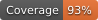

# Repository Coverage

[Full report](https://htmlpreview.github.io/?https://github.com/mcwdsi/bam2tensor/blob/python-coverage-comment-action-data/htmlcov/index.html)

| Name                           |    Stmts |     Miss |   Branch |   BrPart |   Cover |   Missing |
|------------------------------- | -------: | -------: | -------: | -------: | ------: | --------: |
| src/bam2tensor/\_\_init\_\_.py |        1 |        0 |        0 |        0 |    100% |           |
| src/bam2tensor/\_\_main\_\_.py |      189 |        2 |       74 |        2 |     98% |  465, 675 |
| src/bam2tensor/embedding.py    |      160 |        0 |       74 |        0 |    100% |           |
| src/bam2tensor/functions.py    |      367 |       15 |      170 |       12 |     95% |193, 197-199, 470, 483-486, 594-\>601, 763, 830, 838, 842, 878, 886-\>895, 937, 949, 1342-\>1344, 1345-\>1347 |
| src/bam2tensor/inspect.py      |       79 |        4 |       38 |        1 |     96% |178-180, 184 |
| src/bam2tensor/metadata.py     |       43 |        0 |       10 |        0 |    100% |           |
| src/bam2tensor/reference.py    |       70 |        0 |       20 |        0 |    100% |           |
| **TOTAL**                      |  **909** |   **21** |  **386** |   **15** | **97%** |           |

## Setup coverage badge

Below are examples of the badges you can use in your main branch `README` file.

### Direct image

This is the one to use if your repository is private or if you don't want to customize anything.

### [Shields.io](https://shields.io) Json Endpoint

Using this one will allow you to [customize](https://shields.io/endpoint) the look of your badge.
It won't work with private repositories. It won't be refreshed more than once per five minutes.

### [Shields.io](https://shields.io) Dynamic Badge

This one will always be the same color. It won't work for private repos. I'm not even sure why we included it.

## What is that?

This branch is part of the
[python-coverage-comment-action](https://github.com/marketplace/actions/python-coverage-comment)
GitHub Action. All the files in this branch are automatically generated and may be
overwritten at any moment.